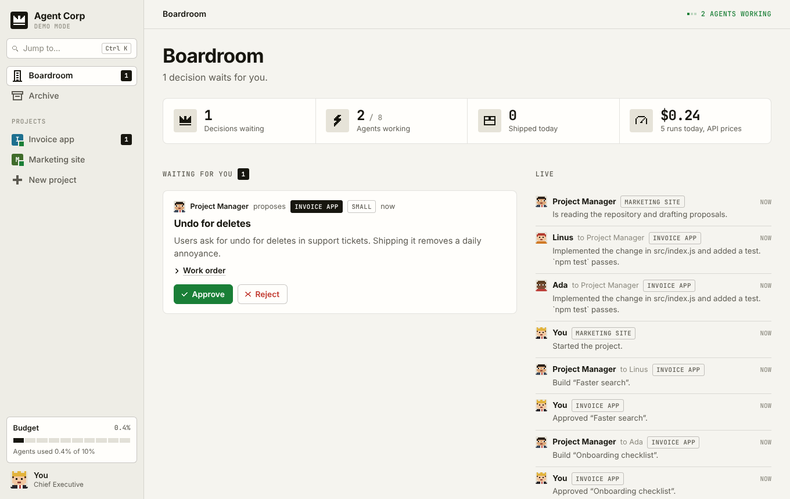

# Agent Corp

A company of headless Claude agents. You are the CEO.

Bring a repository or one rough sentence. The project manager does the thinking: it reads the code, forms its own view of what the product needs, and keeps proposing work for as long as the project runs. That is the centre of this project.

Each project gets a project manager and a team of developers. The project manager reads the repository and proposes work. You approve or reject each proposal, or switch the project to autopilot and step out. Developers build what got approved, the project manager reviews it, and anything the two cannot settle comes back to your desk.




Every agent is a `claude -p` call, so the work runs on the Claude Code login of your machine. With a Pro or Max subscription you pay nothing extra.

## Run it

You need Node 22.13 or newer and Claude Code, logged in (`claude` on your `PATH`).

```sh
npm start        # http://127.0.0.1:4317
npm run demo     # same UI, canned agents, zero Claude calls
npm test
```

The server has no dependencies. Data lives in `./data` (SQLite).

### Desktop app

```sh
npm install      # fetches Electron, once
npm run app      # opens Agent Corp in its own window
npm run app:demo # same, with canned agents
npm run dist     # builds an installer for your system into ./release
```

The app runs the same server inside itself on a private local port, so nothing else needs to be started. It keeps its data in your user application folder, separate from `./data`. It looks for the `claude` binary in the usual install folders, since an app opened from the Dock or Start menu does not see your shell's `PATH`. Set `CLAUDE_BIN` if yours lives elsewhere.

## How work flows

1. **Found a project.** Give it a name, a brief and a folder. Leave the folder empty and you get a fresh git workspace under `data/workspaces`.
2. **Start it.** The project manager reads the repository (read-only tools) and returns proposals as structured output.
3. **Decide.** Approve or reject in the Boardroom. A rejection can carry a reason, and the project manager reads it before the next round. On autopilot this step disappears.
4. **Build.** A free developer picks up the task and runs in the project folder with `--permission-mode acceptEdits` and an allowlist of commands.
5. **Review.** The project manager checks the diff against the work order. It approves, or sends the task back with exact instructions. The same developer resumes its session with `--resume`.
6. **Escalate.** After the configured number of review rounds the task lands on your desk. Accept it, send it back, or cancel it.

You can also send a **directive**: a task you wrote yourself. It skips approval.

## Finding your way around

- **Boardroom.** Your desk: decisions waiting, a live feed of what agents say to each other, every project at a glance.
- **Project.** Four tabs. Overview holds the org chart with live status and your pending decisions. Board is the pipeline, and tickets travel between lanes as work moves. Activity is the full conversation, with tool calls on request. Handovers lists the chats you gave the team.
- **Jump to.** Press Cmd+K or Ctrl+K to open a project, start or pause one, or open the budget.

Motion respects the reduced-motion, reduced-transparency and high-contrast settings of your system.

## Keeping agents inside a budget

Left alone, the loop would run until your subscription limit. Four brakes stop it.

| Brake | Default | Where |
| --- | --- | --- |
| Agents' share of the 5-hour or weekly window | 10% | Budget |
| Stop once the window is this full, your own usage included | 80% | Budget |
| Daily cap in USD at API prices | off | Budget |
| New tasks per project per day | 10 | Project settings |

Claude Code reports how full both subscription windows are after each run. Agent Corp stores the reading it saw first in a window and counts growth from there as the agents' share. If you use Claude yourself during the same window, that usage counts toward the share too, so treat the number as an upper bound.

A closed gate lets running work finish and starts nothing new. It opens when the window resets.

Per-run limits live in project settings: turns per developer run, review rounds per task, proposals per round.

## Chat history

The Archive lists chats from three places.

- **Claude Code sessions on this machine.** The CLI and the desktop app's Code tab write transcripts to `~/.claude/projects`. The Archive reads them live. Nothing to import.
- **claude.ai chats** (the desktop app's Chat tab). These live on Anthropic's servers and have no local file. Request an export at claude.ai under Settings, Privacy, Export data, unzip it, and import `conversations.json`. Importing the same export twice updates chats in place.
- **Notes.** Paste any text: a chat from another tool, meeting notes, a spec.

Cloud sessions from claude.ai/code stay in the cloud and do not appear.

Open a chat and **hand it over** to a project. Claude can compress it into a brief first (one extra run), or you can attach the raw transcript. The project manager and the developers read every handover before each run. For a Claude Code session the Archive also shows the `claude --resume` command that continues it in a terminal.

## What developers may do

By default a developer can read and edit files in the project folder, use git locally (status, diff, log, add, commit) and run `npm test` and `npm run`. Other shell commands are denied, and the developer notes that in its report. Add your own rules in project settings, for example `Bash(pytest *)`.

"Skip all permission checks" maps to `--dangerously-skip-permissions`. Use it inside a container or VM.

Several developers share one working tree. They are told to stage only their own files. For tasks that touch the same code, run one developer.

## Security

The server binds to `127.0.0.1` and has no login. It refuses cross-origin writes. Do not expose the port: anyone who reaches it can start agents that edit your files.

## Configuration

| Variable | Default | Meaning |
| --- | --- | --- |
| `PORT` | `4317` | HTTP port |
| `HOST` | `127.0.0.1` | Bind address |
| `CORP_DATA_DIR` | `./data` | Database and workspaces |
| `CORP_RUNNER` | | `mock` swaps Claude for canned answers |
| `CLAUDE_BIN` | `claude` | Path to the CLI |
| `CLAUDE_CONFIG_DIR` | `~/.claude` | Where the Archive looks for sessions |

## Layout

```
electron/main.js     desktop shell
site/index.html      landing page, one self-contained file
src/server.js        HTTP API, live updates, static files
src/orchestrator.js  the loop: propose, approve, build, review, escalate
src/claude.js        headless runner and its demo stand-in
src/budget.js        subscription readings and the gate
src/history.js       Claude Code sessions, claude.ai exports, notes
src/prompts.js       what each role is told
public/app.js        views
public/dom.js        element builder, keyed morph, layout animations
public/motion.js     springs and the draggable sheet
public/pixels.js     pixel-art icons and agent portraits, drawn on a 10 by 10 grid
```

Built against Claude Code 2.1.
