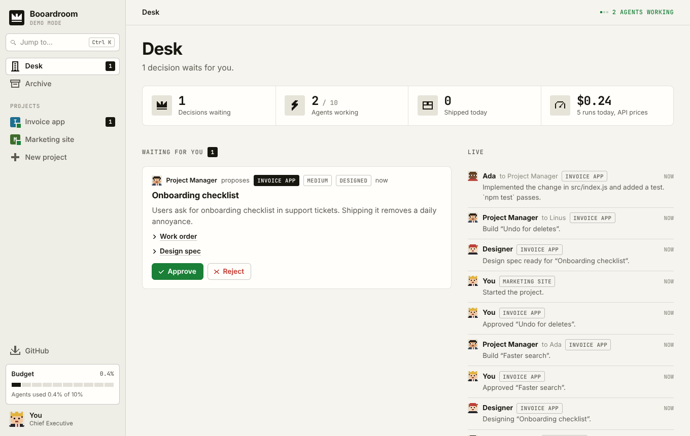
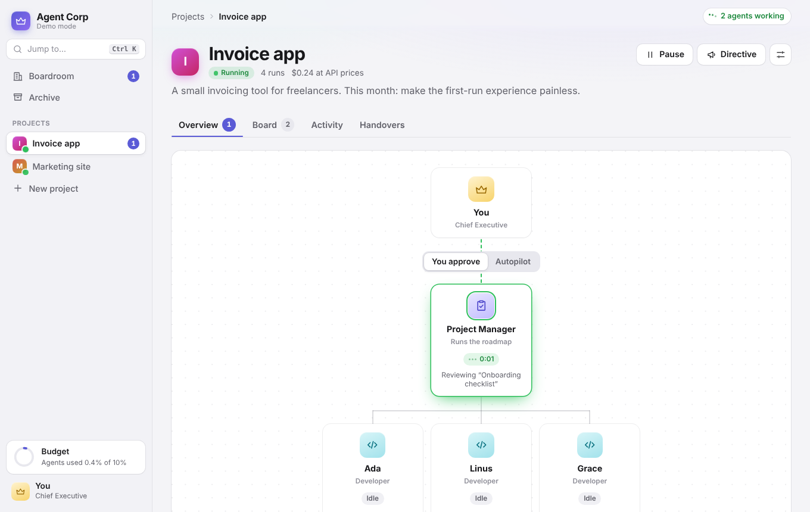

# Booardroom

A company of headless Claude agents. You are the CEO.

Bring a repository or one rough sentence. The project manager does the thinking: it reads the code, forms its own view of what the product needs, and keeps proposing work for as long as the project runs. That is the centre of this project.

Each project gets a project manager, a designer and a team of up to twelve developers. The project manager reads the repository and proposes work. You approve or reject each proposal, or switch the project to autopilot and step out. Developers build what got approved, the project manager reviews it, and anything the two cannot settle comes back to your desk.





Every agent is a `claude -p` call, so the work runs on the Claude Code login of your machine. With a Pro or Max subscription you pay nothing extra.

## Run it

You need Node 22.13 or newer and Claude Code, logged in (`claude` on your `PATH`).

```sh
npm start        # http://127.0.0.1:4317
npm run demo     # same UI, canned agents, zero Claude calls
npm test
```

The server has no dependencies. Data lives in `./data` (SQLite).

### Desktop app

```sh
npm install      # fetches Electron, once
npm run app      # opens Booardroom in its own window
npm run app:demo # same, with canned agents
npm run dist     # builds an installer for your system into ./release
```

### Installers for people who do not use git

The repository builds its own installers on GitHub. Open the **Actions** tab, pick **Installers**, press **Run workflow**, and after about ten minutes download the `.exe` (Windows), `.dmg` (macOS) and `.AppImage` (Linux) from the run's page. Pushing a tag such as `v0.1.0` does the same and attaches the files to a Release, which gives you one download page to send people.

The installers are not code-signed. Windows shows a SmartScreen warning ("More info", then "Run anyway"). macOS refuses to open the app on first try; right-click it and choose Open, or allow it under System Settings, Privacy & Security. Signing removes both warnings and needs a paid certificate from Microsoft and Apple.

The person installing still needs Claude Code on their machine, logged in.

The app runs the same server inside itself on a private local port, so nothing else needs to be started. It keeps its data in your user application folder, separate from `./data`. It looks for the `claude` binary in the usual install folders, since an app opened from the Dock or Start menu does not see your shell's `PATH`. Set `CLAUDE_BIN` if yours lives elsewhere.

## How work flows

1. **Found a project.** Give it a name, a brief and a folder. Pick the folder in Finder or File Explorer with the Choose button, or type the path. Leave the folder empty and you get a fresh git workspace under `data/workspaces`.
2. **Start it.** The project manager reads the repository (read-only tools) and returns proposals as structured output.
3. **Design.** A proposal that changes what a person sees or does goes to the designer first, who writes a design spec for it. The spec travels with the task to the developer.
4. **Decide.** Approve or reject at your Desk. A rejection can carry a reason, and the project manager reads it before the next round. On autopilot this step disappears.
5. **Build.** A free developer picks up the task and runs in the project folder with `--permission-mode acceptEdits` and an allowlist of commands.
6. **Review.** The project manager checks the diff against the work order. It approves, or sends the task back with exact instructions. The same developer resumes its session with `--resume`.
7. **Escalate.** After the configured number of review rounds the task lands on your desk. Accept it, send it back, or cancel it.

### Talking to the manager

Open the **Manager** tab of a project and write to the project manager as you would to a person. It answers, and it acts on what you said:

- A rule or preference ("no frameworks", "everything must work on a phone") goes into a short memo of **standing guidance**. Developers and the designer read that memo before every run.
- A request for specific work becomes tasks with full work orders. They start without further approval, because you asked.
- A change of direction makes the manager withdraw its pending proposals and plan again.

The manager also says so when it disagrees, then does what you decided. It answers while a project is paused; the team acts once the project runs.

You can also send a **directive**: a task you wrote yourself. It skips approval.

## The agents and their master prompts

Each role has a standing job description that rides along on every run as an appended system prompt.

| Role | File | What it sets |
| --- | --- | --- |
| Project manager | `src/roles/project-manager.md` | A six-step method (intent, survey, diagnosis, options, sequence, selection), architectural judgement, how to write a work order, how to review |
| Designer | `src/roles/designer.md` | Read the existing design system first, cover every state, write exact copy, hand over a spec a developer can build from |
| Developer | `src/roles/developer.md` | Understand before changing, smallest change that meets the order, verify for real, report what happened |

Each role also runs on its own model, picked from a dropdown in project settings: Fable 5.2 for the project manager and Opus 5.5 for the designer and developers by default, with Sonnet, Haiku or your Claude Code default as alternatives. A larger model uses more of your Claude limit per run.

To rewrite a role for your company, put a file with the same name in `<data dir>/roles/`. It replaces the built-in one from the next run, no restart needed.

The designer has the Skill tool, so it applies design skills installed in your Claude Code (for example a house style skill) when one fits. It reads a `DESIGN.md`, tokens file or stylesheet in the repository as the source of truth. It does not use claude.ai/design: that product syncs design systems on request from a person and has no headless mode an unattended agent could drive.

## Finding your way around

- **Desk.** Your home screen: decisions waiting, a live feed of what agents say to each other, every project at a glance.
- **Project.** Four tabs. Overview holds the org chart with live status and your pending decisions. Board is the pipeline, and tickets travel between lanes as work moves. Activity is the full conversation, with tool calls on request. Handovers lists the chats you gave the team.
- **Jump to.** Press Cmd+K or Ctrl+K to open a project, start or pause one, or open the budget.

Motion respects the reduced-motion, reduced-transparency and high-contrast settings of your system.

## Keeping agents inside a budget

Left alone, the loop would run until your subscription limit. Four brakes stop it.

| Brake | Default | Where |
| --- | --- | --- |
| Agents' share of the 5-hour or weekly window | 10% | Budget |
| Stop once the window is this full, your own usage included | 80% | Budget |
| Daily cap in USD at API prices | off | Budget |
| New tasks per project per day | 10 | Project settings |

Claude Code reports how full both subscription windows are after each run. Booardroom stores the reading it saw first in a window and counts growth from there as the agents' share. If you use Claude yourself during the same window, that usage counts toward the share too, so treat the number as an upper bound.

A closed gate lets running work finish and starts nothing new. It opens when the window resets.

Per-run limits live in project settings: turns per developer run, review rounds per task, proposals per round.

## Chat history

The Archive lists chats from three places.

- **Claude Code sessions on this machine.** The CLI and the desktop app's Code tab write transcripts to `~/.claude/projects`. The Archive reads them live. Nothing to import.
- **claude.ai chats** (the desktop app's Chat tab). These live on Anthropic's servers and have no local file. Request an export at claude.ai under Settings, Privacy, Export data, unzip it, and import `conversations.json`. Importing the same export twice updates chats in place.
- **Notes.** Paste any text: a chat from another tool, meeting notes, a spec.

Cloud sessions from claude.ai/code stay in the cloud and do not appear.

Open a chat and **hand it over** to a project. Claude can compress it into a brief first (one extra run), or you can attach the raw transcript. The project manager and the developers read every handover before each run. For a Claude Code session the Archive also shows the `claude --resume` command that continues it in a terminal.

## What developers may do

Developers get **the same permissions you give Claude Code**. Before each run Booardroom reads the allow rules from your Claude Code settings, from the project folder's `.claude` settings, and from the "always allow" answers Claude Code remembers for any folder, and passes them on. Allow something in Claude Code and the team has it on their next run. If your Claude Code runs in auto mode or skips permission checks, developers do too.

On top of that each project has its own list. It starts with file tools, local git (status, diff, log, add, commit), `npm test` and `npm run`. In project settings you add commands such as `python3`, `docker` or `curl` with one press.

When a developer reaches a command it may not run, it **stops on the spot**. A request lands on your Desk: "Ada stopped and is waiting for you. Allow python3?" Allow it, keep it blocked, or press **Allow all** to answer every open request at once. Once every request from that task is answered, the same developer continues the same session, knowing what you decided. A command you refused does not stop the team again; the developer works without it and says so in the report. While one task waits, the developer is free for other work.

To keep a project strict, switch its settings to "Only the list below". "Skip all permission checks" maps to `--dangerously-skip-permissions`; use it inside a container or VM.

Several developers share one working tree. They are told to stage only their own files. For tasks that touch the same code, run one developer.

## GitHub

Agents do not sign in to GitHub and do not push. Booardroom holds your account and does both itself, which is why a developer can no longer get stuck on authentication.

- **Connect once.** Open **GitHub** in the sidebar. If the GitHub CLI is logged in on your machine (`gh auth login`), Booardroom uses that sign-in and stores nothing. Otherwise paste a personal access token with the `repo` scope; it is kept in Booardroom's local database, in plain text, on your computer.
- **A deleted repository is noticed.** If you delete a repository on GitHub, the project folder still points at it. Booardroom checks, tells you the repository is gone, and offers to create a new one or unlink the old address.
- **Create the repository with one press.** A project whose folder has no remote shows "Not on GitHub yet" with a Create repository button (private by default), or link one that exists. A folder that is not a git repository gets a "Set up git here" button first.
- **Approved work is pushed for you.** When the manager approves a task, or you accept one, Booardroom pushes the branch. Switch this off per project in settings. "Push now" on the project page pushes on demand.
- **Commits carry your name.** Booardroom sets the commit author for the project folder to your GitHub name and private GitHub address, unless the folder or your machine already names an author.

During a run, developers also get the account in their environment (`GH_TOKEN`), so `gh` and `git` commands you allow them work. They are told not to push or create repositories.

## Security

The server binds to `127.0.0.1` and has no login. It refuses cross-origin writes. Do not expose the port: anyone who reaches it can start agents that edit your files.

## Configuration

| Variable | Default | Meaning |
| --- | --- | --- |
| `PORT` | `4317` | HTTP port |
| `HOST` | `127.0.0.1` | Bind address |
| `CORP_DATA_DIR` | `./data` | Database and workspaces |
| `CORP_RUNNER` | | `mock` swaps Claude for canned answers |
| `CLAUDE_BIN` | `claude` | Path to the CLI |
| `CLAUDE_CONFIG_DIR` | `~/.claude` | Where the Archive looks for sessions |

## Layout

```
electron/main.js     desktop shell
site/index.html      landing page, one self-contained file
vercel.json          serves site/ on Vercel, no build step
src/server.js        HTTP API, live updates, static files
src/orchestrator.js  the loop: propose, approve, build, review, escalate
src/claude.js        headless runner and its demo stand-in
src/budget.js        subscription readings and the gate
src/history.js       Claude Code sessions, claude.ai exports, notes
src/roles/           master prompt per role
src/prompts.js       the task each run is given
public/app.js        views
public/dom.js        element builder, keyed morph, layout animations
public/motion.js     springs and the draggable sheet
public/pixels.js     pixel-art icons and agent portraits, drawn on a 10 by 10 grid
```

Built against Claude Code 2.1.

## Licence

Booardroom is free for personal and other noncommercial use under the [PolyForm Noncommercial License 1.0.0](LICENSE.md). You may run it, study it and change it for yourself.

You may not sell it, resell it, offer it as a paid service, or use it in the work of a business. For a commercial licence, open an issue in this repository.
